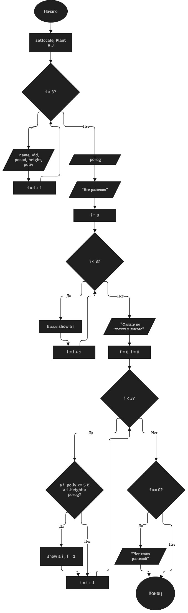

# Домашняя работа 11. Структуры данных

## Условие задачи

**Вариант 6. Запись «Растение».**

Создать структуру для хранения информации о растении. Структура должна содержать следующие поля:
- название;
- вид;
- дата посадки;
- высота в сантиметрах;
- частота полива в днях.

Организовать ввод данных о трех растениях. Вывести сведения о растениях, которые нужно поливать не реже одного раза в 5 дней и высота которых превышает заданное пользователем значение.

## 1. Алгоритм и блок-схема

### Алгоритм

1. Начало программы.
2. Подключение русской локализации.
3. Создание массива из трех структур типа Plant.
4. Организация цикла ввода данных о трех растениях:
   - ввод названия;
   - ввод вида;
   - ввод даты посадки;
   - ввод высоты;
   - ввод частоты полива.
5. Ввод пороговой высоты.
6. Вывод информации обо всех трех растениях.
7. Организация цикла проверки каждого растения.
8. Проверка двух условий:
   - частота полива меньше или равна 5 дням;
   - высота растения больше заданной пороговой высоты.
9. Если оба условия выполняются, вывод информации о растении.
10. Если подходящих растений нет, вывод соответствующего сообщения.
11. Завершение программы.

### Блок-схема



## 2. Реализация программы

```c
#include <stdio.h>
#include <stdlib.h>
#include <locale.h>

struct date {
    int d;
    int m;
    int y;
};

struct plant {
    char name[50];
    char vid[50];
    struct date posad;
    float height;
    int poliv;
};

typedef struct plant Plant;

void show(Plant p)
{
    printf("%s (%s), посадка %02d.%02d.%04d, высота %.1f см, полив каждые %d дн.\n",
        p.name, p.vid, p.posad.d, p.posad.m, p.posad.y, p.height, p.poliv);
}

int main(void)
{
    setlocale(LC_ALL, "Russian");

    Plant a[3];
    int i;

    for (i = 0; i < 3; i++)
    {
        printf("\nРастение %d\n", i + 1);

        printf("Название: ");
        scanf("%49s", a[i].name);

        printf("Вид: ");
        scanf("%49s", a[i].vid);

        printf("Дата посадки (день месяц год): ");
        scanf("%d %d %d", &a[i].posad.d, &a[i].posad.m, &a[i].posad.y);

        printf("Высота (см): ");
        scanf("%f", &a[i].height);

        printf("Частота полива (дней): ");
        scanf("%d", &a[i].poliv);
    }

    float porog;

    printf("\nВведите пороговую высоту (см): ");
    scanf("%f", &porog);

    printf("\nВсе растения:\n");

    for (i = 0; i < 3; i++)
    {
        show(a[i]);
    }

    printf("\nРастения с поливом не реже 1 раза в 5 дней и высотой выше %.1f см:\n", porog);

    int f = 0;

    for (i = 0; i < 3; i++)
    {
        if (a[i].poliv <= 5 && a[i].height > porog)
        {
            show(a[i]);
            f = 1;
        }
    }

    if (!f)
    {
        printf("Нет таких растений.\n");
    }

    system("pause");
    return 0;
}
```

## 3. Результаты работы программы

### Контрольный пример №1

**Входные данные:**

Растение 1:
- Название: Роза
- Вид: Садовая
- Дата посадки: 15 04 2025
- Высота: 45 см
- Частота полива: 3 дня

Растение 2:
- Название: Тюльпан
- Вид: Луковичный
- Дата посадки: 10 09 2025
- Высота: 25 см
- Частота полива: 7 дней

Растение 3:
- Название: Фикус
- Вид: Комнатный
- Дата посадки: 20 03 2024
- Высота: 80 см
- Частота полива: 5 дней

Пороговая высота: 30 см.

**Результат работы:**

```text
Все растения:
Роза (Садовая), посадка 15.04.2025, высота 45.0 см, полив каждые 3 дн.
Тюльпан (Луковичный), посадка 10.09.2025, высота 25.0 см, полив каждые 7 дн.
Фикус (Комнатный), посадка 20.03.2024, высота 80.0 см, полив каждые 5 дн.

Растения с поливом не реже 1 раза в 5 дней и высотой выше 30.0 см:
Роза (Садовая), посадка 15.04.2025, высота 45.0 см, полив каждые 3 дн.
Фикус (Комнатный), посадка 20.03.2024, высота 80.0 см, полив каждые 5 дн.
```

**Вывод:** программа правильно отобрала розу и фикус, так как их частота полива не превышает 5 дней, а высота больше 30 см.

### Контрольный пример №2

**Входные данные:**

Растение 1:
- Название: Кактус
- Вид: Пустынный
- Дата посадки: 12 05 2024
- Высота: 15 см
- Частота полива: 10 дней

Растение 2:
- Название: Орхидея
- Вид: Комнатный
- Дата посадки: 08 02 2025
- Высота: 20 см
- Частота полива: 4 дня

Растение 3:
- Название: Пальма
- Вид: Тропический
- Дата посадки: 01 06 2023
- Высота: 100 см
- Частота полива: 8 дней

Пороговая высота: 25 см.

**Результат работы:**

```text
Все растения:
Кактус (Пустынный), посадка 12.05.2024, высота 15.0 см, полив каждые 10 дн.
Орхидея (Комнатный), посадка 08.02.2025, высота 20.0 см, полив каждые 4 дн.
Пальма (Тропический), посадка 01.06.2023, высота 100.0 см, полив каждые 8 дн.

Растения с поливом не реже 1 раза в 5 дней и высотой выше 25.0 см:
Нет таких растений.
```

**Вывод:** программа правильно определила, что ни одно растение не соответствует одновременно двум заданным условиям.

## 4. Информация о разработчике

Фамилия: Гусакова

Имя: Ксения

Группа: БИЦТ-261
